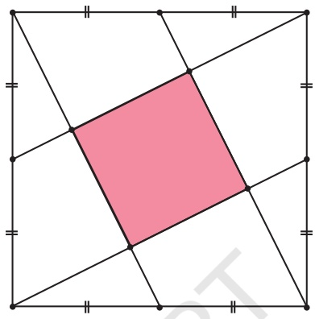

using the given 4-gon. You have to prove that when we place new copies using any of the three procedures, the entire plane is covered with no gaps and no overlaps. First, think carefully about what it means to prove this. Then find a proof for each procedure.

## \*24. What fraction of the square is shaded?

Fig. 12.43

## Chapter Summary

**Quadrilateral:** For four distinct points A, B, C, D in a plane with no three collinear, the **quadrilateral** ABCD is a collection of all points on segments AB, BC, CD, DA provided every point other than A, B, C, and D lies on exactly one of these four segments.

A quadrilateral is **convex** when all of its internal angles are less than 180°, or equivalently, when its diagonals intersect.

• The following converse statements about parallelograms are true:

⸰ If the opposite sides of a 4-gon are equal, then it is a parallelogram.

If the opposite angles of a 4-gon are equal, then it is a parallelogram.

⸰ If the diagonals of a 4-gon bisect each other, then it is a parallelogram.

⸰ If a pair of opposite sides of a 4-gon are equal and parallel, then it is a parallelogram.