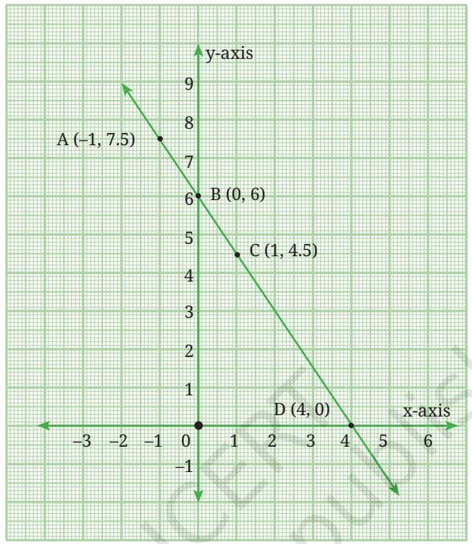

We have already seen in the chapter on Linear Polynomials that plotting the solutions of an equation of the form y = mx + d leads to a straight line joining them. Every solution (x, y) of the equation is a point on the line.

Clearly the solutions of $y = - \frac{3}{2}x + 6$ are the same as those of $3x + 2y = 12$ . Hence the graph of 3x + 2y = 12 is the same as that of $y = - \frac{3}{2}x + 6$

**Example 2:** Find any two solutions of 2x + y = 7. Draw the graph of this equation. Use the graph to find 4 more solutions.

When we substitute x = 0 in the equation, we get $(2 \times 0) + y = 7,$ that is, y = 7. Hence one solution is (0, 7). By substituting y = 0, we get $2x + 0 = 7$ , that is, $x = { \frac { 7 } { 2 } }$ . Thus, $\left( { \frac { 7 } { 2 } } , 0 \right)$ is also a solution.