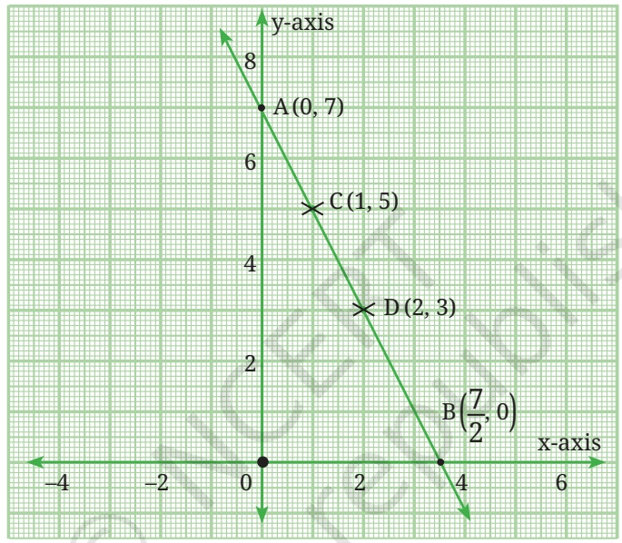

We can represent these solutions or ordered pairs in the form of a table.

<table><tbody><tr><td rowspan="2">x</td><td rowspan="2">0</td><td rowspan="2">72</td></tr><tr></tr><tr><td>y</td><td>7</td><td>0</td></tr></tbody></table>

Using these two points, we can draw the graph of the equation.

Fig. 13.2: Graph of the linear equation 2x + y = 7

From the graph, we see that (1, 5), (2, 3), (3, 1), $\left( { \frac { 3 } { 2 } } , 4 \right)$ are also solutions of $2x + y = 7.$

Note that an easy way of identifying two points on a line is to substitute $x = 0$ in the linear equation and obtain the corresponding value of y. This will give us the point where the line intersects the y-axis. Similarly, we can substitute $y = 0$ and obtain the corresponding value of x. This will give us the point where the line intersects the x-axis.

**Example 3:** Find any two solutions for each of the following equations and draw their graphs:

(i) $4x + 3y = 12$ (ii) 2x + 5y = 0

**Solution:**

(i) Substituting $x \quad = \quad 0$ in the equation, we get $3 y ~ = ~ 1 2 ,$ that is, $y = 4.50 (0,4)$ is a solution of the given equation. Similarly, by substituting $y = 0 ,$ , we get x = 3. Thus, (3, 0) is also a solution.