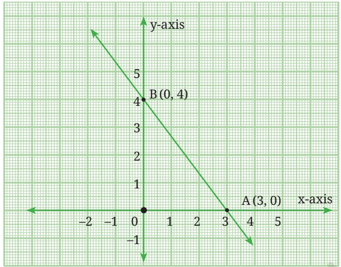
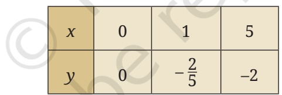
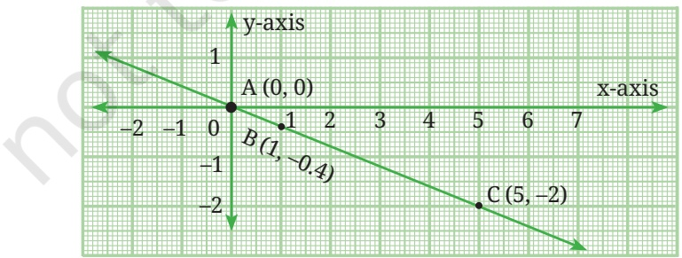

Fig. 13.3: Graph of the linear equation 4x + 3y = 12

(ii) Substituting $x = 0 ,$ we get 5y = 0, that is, y = 0. So (0, 0) is a solution of the given equation. To get another solution, substitute x = 1. The corresponding value of y is $-\frac{2}{5}, \mathrm{~S}0, (1, -\frac{2}{5})$ is also a solution. In fact, we can substitute any value for x and obtain a corresponding value of y. For example, substituting $x = 5$ we obtain $y = - 2$ . Let us represent these solutions or ordered pairs in the form of a table.

When we plot the ordered pairs A (0, 0), $\mathrm { B } \left( 1 , { \frac { - 2 } { 5 } } \right)$ and C (5, –2) we see that they lie on a line.

Fig. 13.4: Graph of the linear equation $2x + 5y = 0$