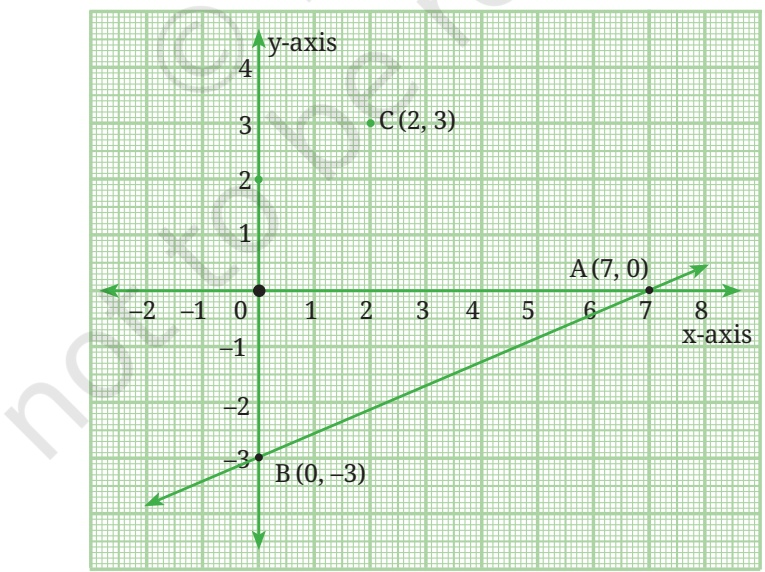

## Exercise Set 13.2

1. Verify if the ordered pair (4, 3) is a solution of 5x – 6y = 2. Explain your reasoning.

2. Find any two solutions for each of the following equations: (i) 7x – 3y = 21 (ii) 2x + 3y = 5

3. In the equations given below, m and n are unknown constants: 2mx + 3y = 7; 4x + ny = –10. If (2, –1) is the solution of both equations, find the values of m and n.

4. Find two solutions which lie in different quadrants for each of the following linear equations. Identify the quadrants in which the points lie. (i) $5x + 3y = 7$ (ii) $5x - 3y = 7$ (iii) –5x + 3y = 7 (iv) –5x – 3y = 7

Verify your solutions by representing the linear equations on a graph paper.

5. Consider the graph of the equation 3x – 7y = 21 shown below. Does the point C (2, 3) lie on the line? Does it satisfy the equation? Can points that do not lie on the line satisfy the equation?

