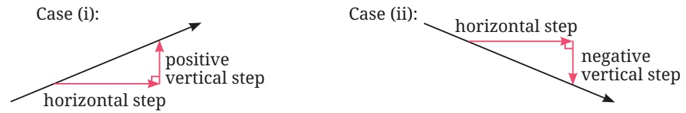
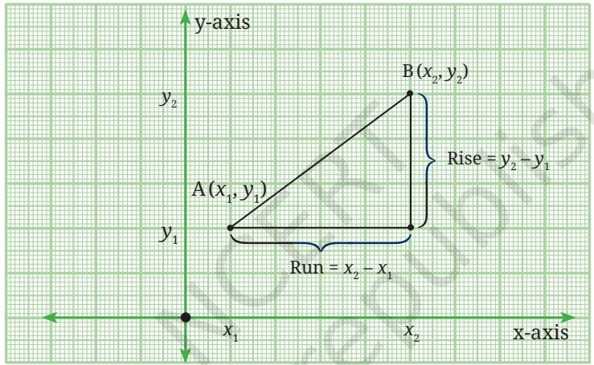

Fig. 13.5

Fig. 13.5: (i) represents the case of a positive slope, whereas (ii) represents that of a negative slope.

Let us consider a line passing through two points $\mathrm { A } ( x _ { 1 } ,   y _ { 1 } )$ and $\mathrm { B }   ( x _ { _ 2 } , y _ { _ 2 } )$

Fig. 13.6

The horizontal distance between the two points is $( X _ { _ 2 } - X _ { _ 1 } )$ and is often referred to as the **Run**. It tells you how far the line goes to the left or right. Moving to the right means a positive run while moving to the left means a negative run.

The vertical distance between the two points is $( \boldsymbol { y } _ { 2 } - \boldsymbol { y } _ { 1 } )$ and is often referred to as the **Rise**. It tells you how much the line goes up or down when moving from one point to another. If the line goes up, the rise is positive. If the line goes down, the rise is negative.

$$
The slope of a line = \frac{ Riesz }{ Run } = \frac{y_2 - y_1}{X_2 - X_1}.
$$

Consider the graph of the equation shown in Fig. 13.7 which passes through the points A (2, 0) and B (4, 3).