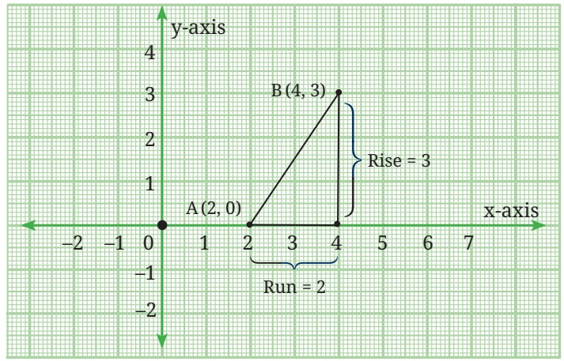
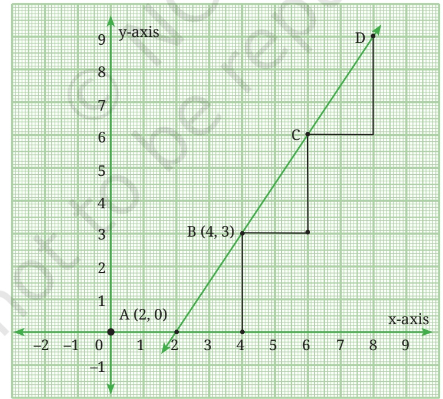

Fig. 13.7

Point B can be reached from point A by moving 2 units along the positive x-direction (the run), and 3 units along the positive y-direction (the rise). Hence slope of the $\mathrm{line} = \frac{\mathrm{Rise}}{\mathrm{Run}} = \frac{3}{2}.$

Now consider the same line AB further extended beyond B as shown in Fig. 13.8.

