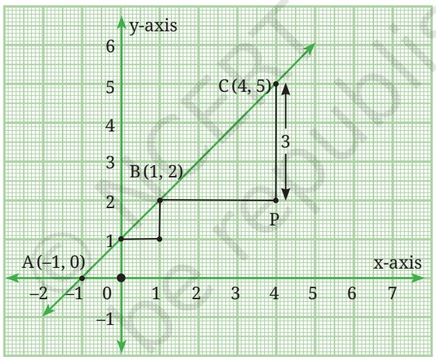

The slope of the line using points A and B is $\frac { 3 } { 2 }$ and using B and D we get $\frac { 6 } { 4 }   =   \frac { 3 } { 2 }$ . We may therefore conclude that the slope of the line remains the same and is independent of where we measure it on the line.

## Think and Reflect

1. Consider the point on the line AB whose x-coordinate is 8. What is the y-coordinate of this point? Express this as an ordered pair.

2. What is the x-coordinate of the point on the line AB whose y-coordinate is 6? Express this as an ordered pair.

B (1, 2), and C (4, 5). Plot the points and find the slope of the line.

Fig. 13.9

Take any two points, say B and C, and find the ratio of vertical step (rise) to the horizontal step (run).

Hence, slope $\frac{\mathrm{CP}}{\mathrm{BP}} = \frac{5 - 2}{4 - 1} = 1$

It may be verified that we will get the same slope by considering any two points.

**Example 6:** Consider the line in Fig. 13.10 which passes through A (– 4, 5) and B (–1, 2). Find the slope of the line.