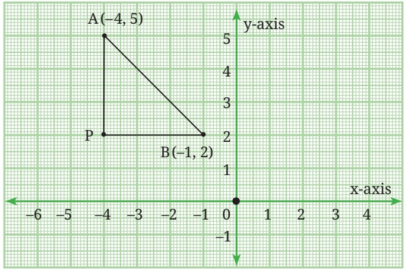

Fig. 13.10

If we denote the points A(–4, 5) and B (–1, 2) as $( x _ { 1 } , y _ { 1 } )$ and $( x _ { \mathrm { { } _ { 2 } } } , y _ { \mathrm { { } _ { 2 } } } )$ respectively, then

$$
\mathrm{Suppose} = \frac{\mathrm{AP}}{\mathrm{BP}} = \frac{2 - 5}{- 1 - ( - 4)} = \frac{- 3}{3} = - 1.
$$

$(x_{1},y_{1})$ and A(–4, 5) as $( x _ { _ 2 } , y _ { _ 2 } )$ then

$$
\mathrm{Slope} = \frac{\mathrm{PA}}{\mathrm{PB}} = \frac{5 - 2}{- 4 - ( - 1)} = \frac{3}{- 3} = - 1.
$$

Hence the slope remains the same irrespective of the order in which we choose the points.

In general, if $(x_{1},y_{1})$ and $(x_{2},y_{2})$ are two points on a line, the slope is given by the expression $\frac{y_{2}-y_{1}}{x_{2}-x_{1}}$ and it remains the same for any two points on the line. There is a simple and elegant proof of this result which you will see below.

## 13.3.2 Slope-Intercept Form

In the chapter on linear polynomials, we were introduced to the fact that in the linear equation $y = mx + d, \text{" } m \text{" }$ represents the slope or steepness of the line while ‘d’ represents the y-intercept, that is, the length cut off by the line on the y-axis from the origin. Thus, y = mx + d is also referred to as the **slope-intercept form of a line**.