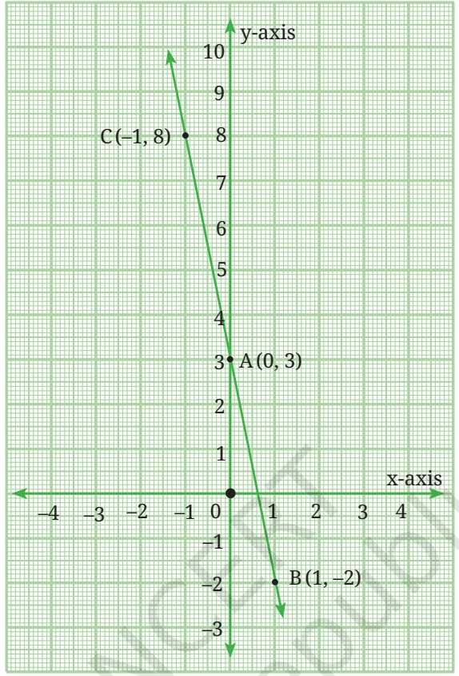

Fig. 13.11: Graph of the linear equation y = –5x + 3

Let us further explore the geometrical meaning of the slope of a line y = mx + d. To do this we will consider the following cases:

1. Positive Slope (m > 0). The line goes upward from left to right. As x increases, y increases. In y = 2x + 1, the slope is m = 2. It means for every unit you move to the right, you also go up 2 units.

2. Negative Slope (m < 0). The line goes downward from left to right. As x increases, y decreases. In y = –3x + 4, the slope is m = –3. It means for every unit you move to the right, you go down by 3 units.

3. Zero Slope (m = 0). In this case the line is horizontal and parallel to the x-axis. That is, y remains constant as x changes. For example, in y = 5, the slope = m = 0.