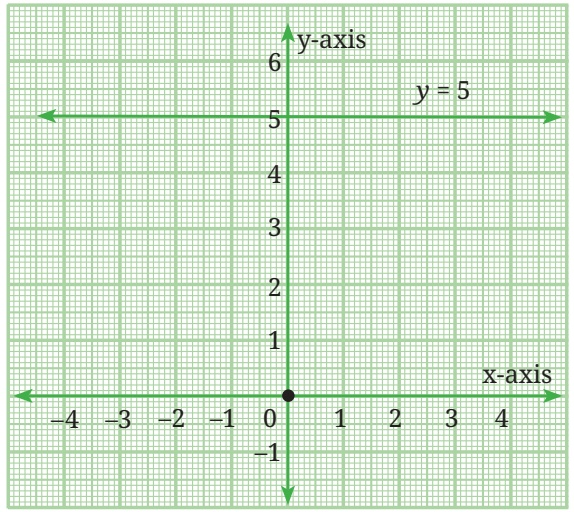
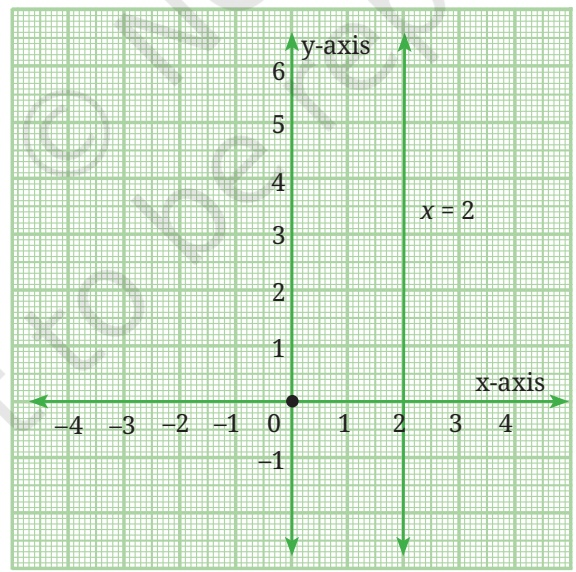

Fig. 13.12: Graph of y = 5

4. Undefined Slope. Here the line is vertical and parallel to the y-axis. x is constant as y changes. The line x = 2 is an example. But it is not of the form y = mx + d. While calculating the slope of this line we get 0 in the denominator. Since division by 0 is undefined, we take the slope also to be undefined.

Fig. 13.13: Graph of x = 2