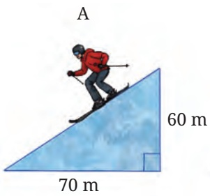
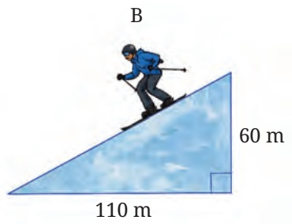
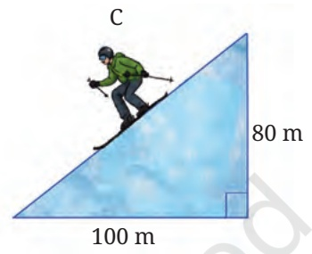
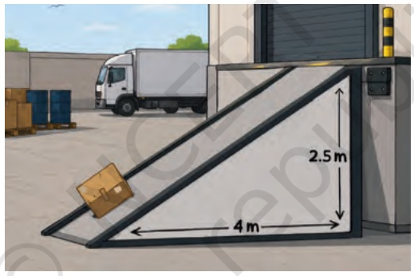
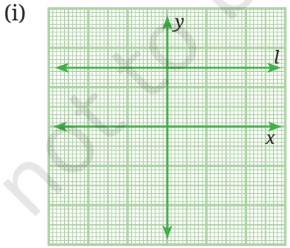
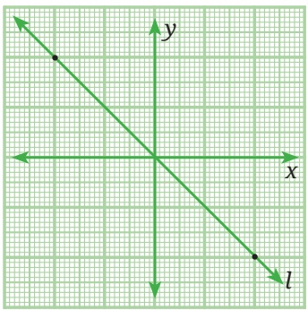

## Exercise Set 13.3

1. The following diagrams represent ski hills. Rank the hills in order of their steepness, from least to greatest.

2. The ramp at a loading dock rises 2.5 metres over a run of 4 metres. Find the slope of the ramp.

3. Find the slope of the line l in each of the following diagrams.

(ii)

