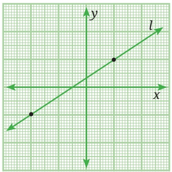
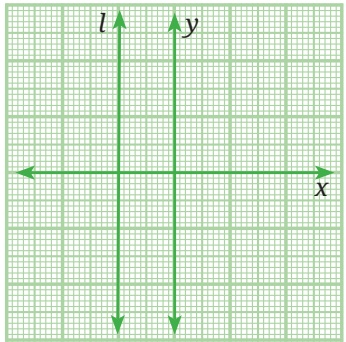
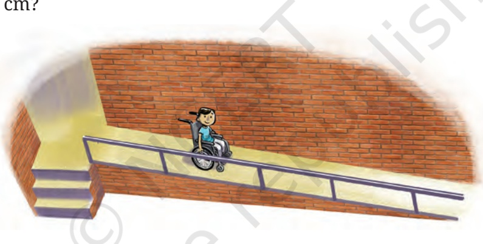

(iii)

(iv)

4. An accessibility ramp for wheelchairs is to be made alongside the staircase. The guidelines given for the slope of the ramp is 1 cm vertical rise to 12 cm horizontal length. What should be the horizontal length of the ramp if the total height of the stairs is 18 cm?

13.4. Pair of Linear Equations in Two Variables

90/- 1 + 2 ParathaDahi

260/- 2 + 7 ParathaDahi

