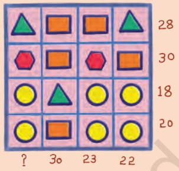

## 13.5.1 Algebraic Methods for Solving a Pair of Linear Equations

## Think and Reflect

Solve the puzzle and discuss your strategy with your friends. Can you determine the value represented by each shape?

We note from the first row that the values of 2 triangles and 2 rectangles add up to 28. We may express this as $2T + 2R = 28$ or as $\mathrm{T} + \mathrm{R} = 14$ . Similarly, the last column may be written as $2C + T + R = 22$ Here T, S and C represent the values assigned to a triangle, a rectangle and a circle respectively.

Since we know that T + R = 14, we can rewrite the second equation as $2C + 14 = 22$ , solving which, we get $\mathbb { C } \equiv 4 .$ . Once you have the value of C, you can find the values of the other shapes. Try it for yourself.

We will now learn two methods for solving a pair of linear equations. One is called the **method of substitution** while the other is referred to as the **method of elimination**.

**Substitution Method:** We will demonstrate the method of substitution by solving a pair of linear equations in two variables.

**Example 7:** Solve the following pair of equations by substitution method:

$$
7x - 15y = 2\tag{1}
$$

$$
x + 2y = 3\tag{2}
$$

## Solution:

**Step 1:** We select either of the equations and express one variable in terms of the other.

Let us consider Equation (2), that is, x + 2y = 3 and write it as

$$
x = 3 - 2 y\tag{3}
$$

**Step 2:** Clearly, all $( x , y )$ that satisfy both the given equations must also satisfy $x = 3 - 2 y$ . Since this relation must hold true in Equation (1), substituting $x = 3 -$ 2y in it we get

$$
7(3 - 2y) - 15y = 2
$$