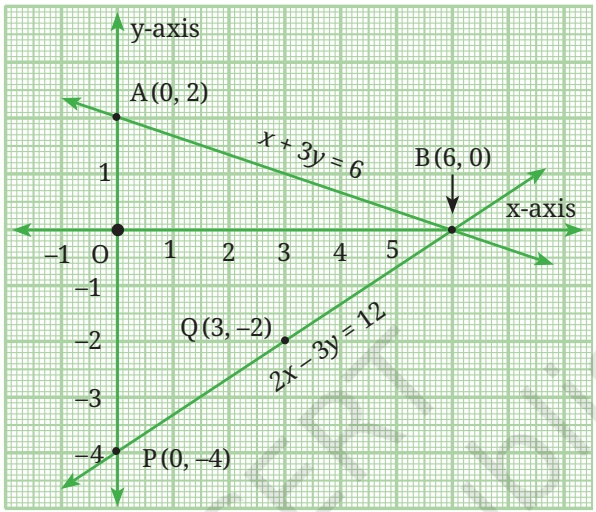

Now plot the points A (0, 2), B (6, 0), P (0, – 4) and Q (3, – 2) on a graph paper, and join the points to form the lines AB and PQ as shown in Fig. 13.14. We observe that the point B(6, 0) is common to both the lines. In fact the lines AB and PQ intersect at B. So, the solution of the pair of linear equations is x = 6 and y = 0. Also, we can say that the given pair of equations has a **unique solution**.

Fig. 13.14: Graph of the pair of linear equations x + 3y = 6 and $2x - 3y = 12.$ They have the unique solution (6, 0) or x = 6, y = 0

If we consider the ratios of the corresponding coefficients and constants in the equations $x + \underline{3}y = 6$ and $2x - 3y = 12,$ , we get $\frac { a _ { _ 1 } } { a _ { _ 2 } } = \frac { 1 } { 2 }$ $\frac{b_{_1}}{b_{_2}}=\frac{3}{-3}=-1$ . Here $\frac{\overline{a}_{1}^{-} \neq \overline{b}_{1}^{-}}{a_{2}^{-}}$ We have also seen graphically that the lines intersect.

**Example 12:** Determine if the lines $x + 2y - 4 = 0$ and $2x + 4y - 12 = 0$ intersect, coincide or are parallel to each other. Then verify your answer by graphing the equations.

On comparing the coefficients of these two equations we get $\frac { a _ { _ 1 } } { a _ { _ 2 } } = \frac { 1 } { 2 }$ $\frac{b_{1}}{b_{2}} = \frac{2}{4} = \frac{1}{2}, \frac{c_{1}}{c_{2}} = \frac{- 4}{- 12} = \frac{1}{3}$ . We observe that $\frac { a _ { _ 1 } } { a _ { _ 2 } } = \frac { b _ { _ 1 } } { b _ { _ 2 } }$ but is not equal to $\frac { c _ { _ 1 } } { c _ { _ 2 } }$ Thus, the equations have no solution and hence the lines are parallel.

As before, we identify the points (0, 2) and (4, 0) on the line $x + 2y - 4 = 0$

| x | 0 | 4 |
| --- | --- | --- |
| y | 2 | 0 |