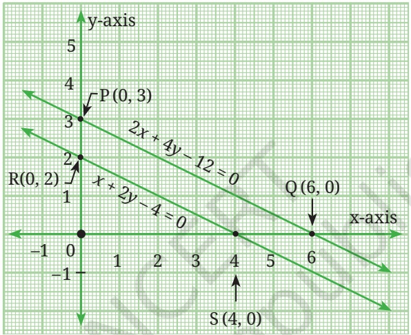

Similarly we find two points on the line 2x + 4y – 12 = 0, say, (0, 3) and (6, 0).

| x | 0 | 6 |
| --- | --- | --- |
| y | 3 | 0 |

To represent the equations graphically, we plot the points R(0, 2) and S(4, 0), to get the line RS and the points P(0, 3) and Q(6, 0) to get the line PQ.

Fig. 13.15: Graph of the pair of linear equations 2x + 4y – 12 = 0 and x + 2y – 4 = 0

We observe in Fig. 13.15 that the lines do not intersect anywhere and are parallel.

## Think and Reflect

Can you prove that two lines of equal slope are parallel?

(**Hint:** Consider the equations of the two lines to be y = mx + d and y = mx + d )

**Example 13:** Romila went to a stationery shop and purchased 2 erasers and 3 A4 sheets for ₹9. Her friend Sonali saw the new variety of erasers and A4 sheets Romila bought, and she also bought 4 erasers and 6 A4 sheets of the same kind for ₹18. Represent this situation graphically.

Let us denote the cost of a erasers by ₹x and one A4 sheets by ₹y. Then the algebraic representation is given by the equations 2x + 3y = 9 and 4x + 6y = 18. Writing these equations in standard form we get 2x + 3y – 9 = 0 and 4x + 6y – 18 = 0.