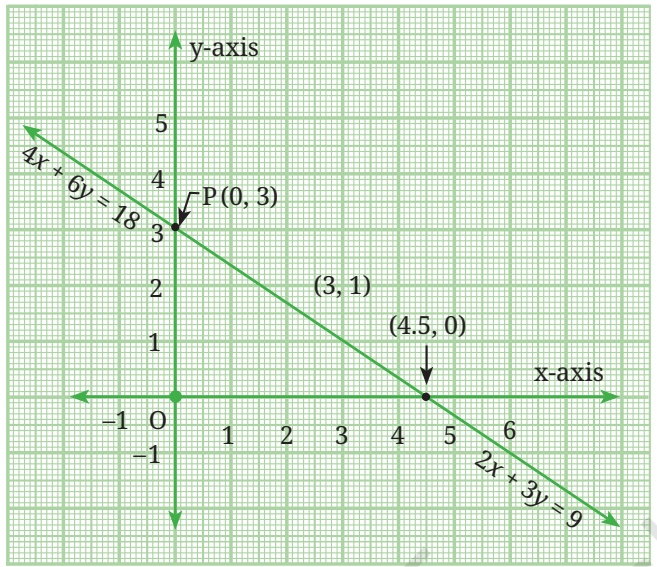

Fig. 13.16: Graphs of the pair of linear equations 2x + 3y = 9 and 4x + 6y = 18. The two lines coincide.

We find that both equations are represented by the same straight line. On comparing the coefficients of the two equations we find that $\frac{a_{1}}{a_{2}}=\frac{2}{4}=\frac{1}{2}, \frac{b_{1}}{b_{2}}=\frac{3}{6}=\frac{1}{2}, \frac{c_{1}}{c_{2}}=\frac{-9}{-18}=\frac{1}{2}$ which represents the fact that the pair of lines has infinitely many solutions.

## Exercise Set 13.5

1. Form a pair of linear equations for each of the following problems and find their solutions.

(i) The sum of two integers is +5 and their difference is –21. Find the two numbers.

(ii) The difference between two numbers is 26 and one number is three times the other. Find the numbers.

(iii) The coach of a cricket team buys 7 bats and 6 balls for ₹8880. Later, she buys 3 bats and 5 balls for ₹4000. Find the cost of each bat and each ball.

(iv) The taxi charges in a city consist of a fixed charge together with the charge for the distance covered for every km. For a distance of 10 km, the total amount paid is ₹155 and for