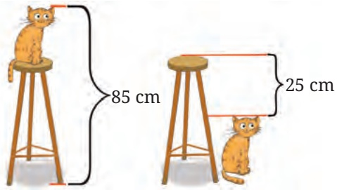

4. Which of the following pairs of linear equations have solutions? If they have solutions, find them graphically.

(i) $x+y=5, \quad 2x+2y=10$

(ii) $x - y = 8,  3x - 3y = 16$

(iii) $2x+y-6=0,4x-2y-4=0$

(iv) $2x - 2y - 2 = 0, \\ 4x - 4y - 5 = 0$

5. Half the perimeter of a rectangular garden, whose length is 4 m more than its width, is 36 m. Find the dimensions of the garden.

6. Given the linear equation $2x + 3y - 8 = 0$ , write another linear equation in two variables so that the graphs of the pair formed represent (i) intersecting lines (ii) parallel lines (iii) coincident lines.

7. Here is a problem that was posed by Mahāvīrāchārya in Gaṇita sāra saṅgraha (c. 850 CE).

The price of 9 citrons and 7 fragrant wood-apples taken together is 107; and the price of 7 citrons and 9 fragrant wood-apples taken together is 101.

O mathematician, tell me quickly the price of each citron and of each fragrant wood-apple.

(**Hint:** The given problem can be modelled as

$$
\frac{9x + 7y = 107}{7x + 9y = 101}
$$

Can you figure out a way of solving these equations without directly using elimination or the substitution method? What is special in this pair of equations? The x and y coefficients are interchanged in the 2 equations.

What will happen if we add the pair of equations? What will happen if we subtract the pair of equations? Can the resulting equations be solved to find the values of x and y?)

8. 5 pencils and 7 pens together cost ₹50, whereas 7 pencils and 5 pens together cost ₹46. Find the cost of each pencil and pen.

9. Find the height of the stool.

