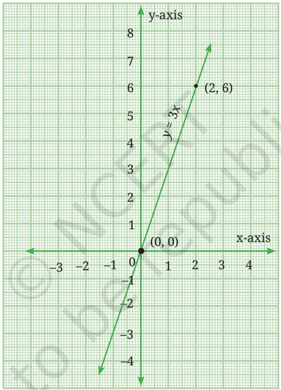

## End-of-Chapter Exercises

1. The graph of the line y = 3x, passing through (0, 0) and (2, 6) is given below.

(i) Identify the slope of the line from the graph and explain how you calculated it using the two points on the line.

(ii) What is the y-intercept of the line? Explain its significance.

(iii) A water tank is being filled so that the water level y (in cm) after x minutes follows this graph.

(a) How high is the water after 5 minutes?

(b) How many minutes will it take for the water to reach a height of 21 cm?

(iv) Without drawing a new graph, determine whether the point (4, 10) lies on this line. Justify your answer.

(v) Plot the point where this line intersects the line x = 3. Explain how you found the coordinates.