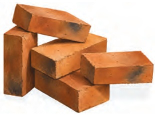
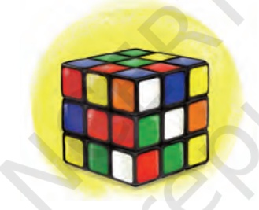
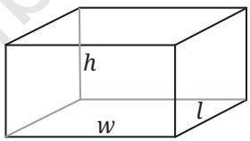
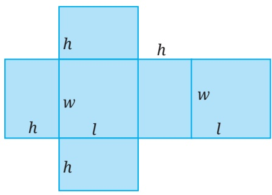

# Math of Space: Surface Area and Volume

0905CH14

In the previous grade we explored nets of some solids including cubes, cylinders, and cones. We saw that solids have a surface and occupy some space or volume. In this chapter, we will learn how to determine surface areas and volumes of cuboids, cylinders, cones, pyramids, and spheres, and how we can use these to solve some interesting problems.

## 14.1 Cuboids and Cubes

Fig. 14.1A: Cuboid bricks

Fig. 14.1B: Rubik’s Cube

Fig. 14.1C: Cuboid

A cuboid has the shape shown in these pictures. A useful way of thinking about a cuboid is that it is a ‘three-dimensional (3D) version’ of a rectangle.

It has six faces, all rectangles. It is characterised by three quantities: length, width, and height — these are denoted by l, w, h respectively.

You can cut out the net of a cuboid given at the end of the textbook, make appropriate folds and join the edges to form the cuboid.

What is the total surface area of a cuboid? You may refer to the net of the cuboid given in Fig. 14.2.

Considering the faces individually, we see that the total surface area (TSA) of the cuboid is

$$
\mathrm{TSA} = 2(wl + hl + hw).
$$

Fig. 14.2