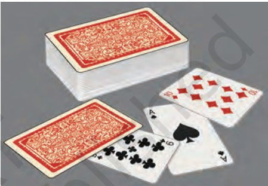
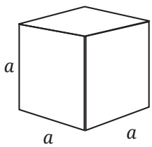

Volume measures the amount of three-dimensional space an object or a container occupies. It is measured in cubic units, e.g., cubic meters $( m ^ { 3 } )$ or cubic centimeters (cm3). We set the volume of a unit cube (i.e., a cuboid measuring one unit in each direction) to be one cubic unit (e.g., 1 $\mathrm { m ^ { 3 } }$ or 1 cm3, as the case may be). The volume of a general cuboid is the number of unit cubes that fit into it. Accordingly, the formula for the volume $V$ of a cuboid is length × width × height or

$$
V   =   l w h .
$$

Compare the formula for the volume of a cuboid with the formula for the area of a rectangle (length × width).

Here is a way of understanding why the formula V = lwh is true: think of a cuboid as a large number of thin rectangular pieces (length $l ,$ width w) stacked on top of each other, like a pack of playing cards. (Fig. 14.3).

Fig. 14.3

## Think and Reflect

Try to work out for yourself why this model explains the formula for the volume of a cuboid, i.e.,

$$
\underline { { \mathrm { v o l u m e } } } = \underline { { \mathrm { a r e a } } } \underline { { \mathrm { o f } } } \; \mathsf { b a s e } \times \mathsf { h e i g h t } .
$$

Write the formula for the surface area and the volume of a cube.

A particular and important case of a cuboid is a cube, whose length, width, and height are the same. This length is the ‘side’ of the cube.

Let the side be $a .$ Then:

• Total surface area of the cube is $6 a ^ { 2 }$

Fig. 14.4

• Volume of the cube is $a ^ { 3 }$ .

Observe how these two formulas are special cases of the formulas 2(wl + hl + hw) and whl, when $w = h = l ,$