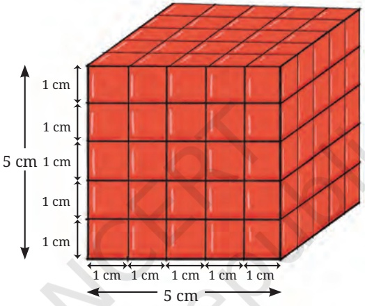

5. A cube of side 4 cm is cut into cubes of side 1 cm. What is the ratio of the surface areas of the original cube and all the cut-out cubes? (Note that there is no change in volume but a big change in the surface area. This property has major consequences in the biological world.)

6. The surface areas of the three faces of a cuboid that meet at one of the corners of the cuboid are 6 cm2, 15 cm2, and 10 cm2 respectively. What is the volume of the cuboid?

\*7. A cube of side 5 cm is painted on all its faces. If it is sliced into 1 $\mathbf { c m } ^ { 3 }$ cubes, how many of these 1 cm3 cubes have

(i) exactly three faces painted?

(ii) exactly two faces painted?

(iii) exactly one face painted?

(iv) no face painted?

\*8. Find a cuboid with edges whose lengths are integers (in cm), given that it has a total surface area of exactly 100 cm2.

(i) Is there more than one such cuboid?

(ii) Can you find them all?

(iii) Show that you have found them all.

## Think and Reflect

Suppose a swimming pool is being built in your school. Two choices are available for the dimensions of the pool: (A) 8 ft (depth) × 50 ft × 20 ft and (B) 6 ft (depth) × 100 ft × 15 ft. Which option would be suitable/appropriate for your school? Why? What parameters/aspects did you consider to make the choice? [1 cubic foot ≈ 28.3 litres]