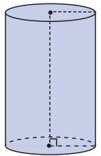
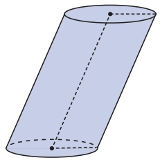
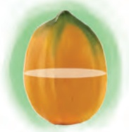
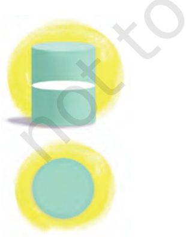
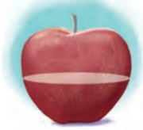
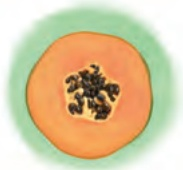
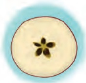

## 14.2 Right Circular Cylinder

The following figures show different types of cylinders. What is different in each of these cylinders?

Right circular cylinder

Oblique circular cylinder

The first one is a **right circular cylinder**. The term circular indicates that the cross-section of the cylinder is a circle, while the term right signifies that the axis of the cylinder is perpendicular to its circular base. Many pipes have this shape. It is worth noting that not all cylinders are of this type. Some cylinders may have axes that are inclined rather than perpendicular to the base. The second one is an **oblique circular cylinder**. We restrict ourselves to the study of the right circular cylinder only. You can cut out the net of a cylinder given at the end of the textbook, make appropriate folds and join the circles to form the cylinder.

We used the word **cross-section** above. Given a three-dimensional object, suppose we take an extremely thin slice of it. The shape we get is called a ‘cross-section’ of the object. In the case of a cylinder, if the slice is parallel to its base, we get a circular cross-section. But if the slice is parallel to the axis of the cylinder, we get a rectangular cross-section. Generally, we are interested in the cross-section that is parallel to the base.

Examples of cross-sections are shown in the following figure.

Cylinder

Papaya

Apple