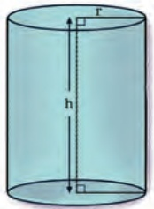
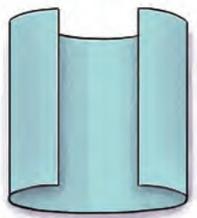
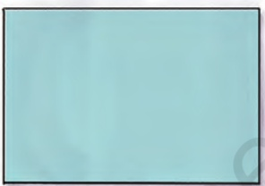
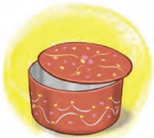
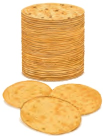

When doctors take an MRI scan of some part of your body, it is like taking a cross-section because it allows them to look at the inside of your body in slices.

What is the area of the curved surface of a cylinder?

Let the radius of the circular base of the cylinder be $r ;$ let its height be h. Suppose the cylinder is cut as shown in the figure below. We get a rectangle.

Fig. 14.5A

Therefore, the curved surface area of the cylinder is the area of the rectangle.

• The curved surface area (CSA) of the cylinder is

$$
\mathrm{CSA}=\mathrm{circun~free~nc~} \times \mathrm{height}=2 \pi r h.
$$

If the cylinder is closed at both ends (top and bottom) like a biscuit tin (see Fig. 14.5B), then the flat circular surfaces at the ends also contribute to the area. Since there are two ends,

total surface area $(TSA) = 2\pi r h + 2\pi r^{2} = 2\pi r(h + r).$

If the cylinder is closed at one end and open at the other end, like a tumbler, then

Fig. 14.5B

$$
{ \mathrm { s u r f a } } { \overline { { \mathrm { c e } } } } { \mathrm { a r e a } } = 2 \pi r h + \pi r ^ { 2 } = \pi r ( 2 h + r ) .
$$

The volume V of the cylinder is

V = cross-sectional area × height = πr2h.

## 14.2.1 Another Way of Understanding Why the Above Formulas Are True

To understand why the formulas for the surface area (curved part) and the volume of a cylinder hold, it helps to think of the cylinder as a large number of thin circular khakhras stacked on one another.

