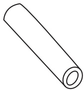

**Example 2:** Savitri had to make a model of a cylindrical kaleidoscope for her science project. She wanted to use chart paper to make the curved surface of the kaleidoscope (see Fig. 14.6). What would be the area of chart paper required by her, if she wanted to make a kaleidoscope of length 25 cm with a

3.5 cm radius? You may take $\pi = { \frac { 2 2 } { 7 } }$

Fig. 14.6

Radius of the base of the·cylindrical kaleidoscope (r) = 3.5 cm.

Height (length) of kaleidoscope (h) = 25 cm.

Area of chart paper required = curved surface area of the kaleidoscope

$$
\begin{aligned}&= 2\pi r h \\&= 2 \times \frac{22}{7} \times 3.5 \times 25 \;  cm ^2 \\&= 550 \;  cm ^2\end{aligned}
$$

## Exercise Set 14.2

Two cylinders, A and B, are given. The radius of cylinder B is twice that of cylinder A, and the height of cylinder B is half that of cylinder A. Find the ratio of the curved surface area of A to the curved surface area of B. Also find the ratio of the volume of A to the volume of B.

2. The radii of two cylinders are in the ratio 2:3, and their heights are in the ratio 3:2. Find (a) the ratio of their volumes, and (b) the ratio of their curved surface areas.

3. The edge of a cube measures r cm. The largest possible right circular cylinder is cut out of the cube. What do you think is the volume of the cylinder (in cm3)?

\*4. The radius of the base of a cylinder is increased by 10%. At the same time, the height of the cylinder is decreased by x%. Given that the volume of the cylinder remains unchanged, find the value of x.

5. A solid metallic cube of side 12 cm is melted and recast into solid cylindrical rods, each having radius 2 cm and height 12 cm. Find: (i) the volume of the cube,