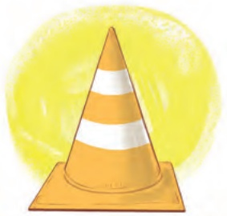
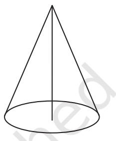
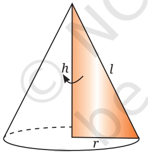
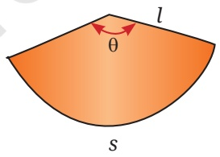

(ii) the volume of one cylindrical rod, (iii) the approximate number of complete cylindrical rods that can be formed. $\left( \pi \approx { \frac { 2 2 } { 7 } } \right)$

## 14.3 Cones

Fig. 14.7A

Fig. 14.7B

Fig: 14.7C

A right circular cone is generated when a right triangle is rotated about one of its legs. The relationship among the slant length l, the height h, the radius r of the base is

$l ^ { 2 } = h ^ { 2 } + r ^ { 2 }$ (using the Baudhāyana–Pythagoras theorem)

Right circular cone

Unrolled cone

Fig. 14.8

Imagine cutting the cone along a slant edge and ‘opening $\mathrm { { \bf u p } ^ { \prime } }$ or unrolling the surface. The unrolled surface has the shape of a sector of a circle. To create the cone again, bring the two straight edges together. You can use the cutout of the net of a cone given at the end of the textbook to make a cone.

What is the curved surface area of a cone?

The formula for surface area becomes clear if we imagine cutting the cone along a slant edge, unrolling the surface, and cutting it up into