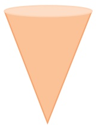
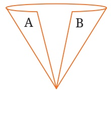
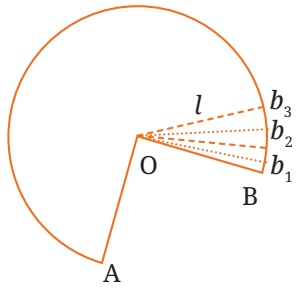

a large number of very thin sectors, each of which can be regarded as a narrow isosceles triangle of height l (Fig. 14.9).

(a)

(b)

(c)

Fig. 14.9

From Fig. 14.9, it follows that the curved surface area (CSA) of the cone is equal to

$$
\begin{aligned}\mathrm{CSA} = \frac{1}{2}b_{_1}l + \frac{1}{2}b_{_2}l + \cdots + \frac{1}{2}b_{_n}l = \frac{1}{2}(b_{_1} + b_{_2} + \cdots + b_{_n})l \\= \frac{1}{2} \times \mathrm{circm} & \mathrm{reference} \mathrm{of the base} \times l \\= \frac{1}{2}(2\pi r)l = \pi r l\end{aligned}
$$

Here is another way of working out the formula for the curved surface area. We have, from the formula for area of a sector of a circle,

$$
\mathrm{CSA} = \pi l^{2} \times \frac{\theta^{\circ}}{360^{\circ}} = \pi l \times l \times \frac{\theta^{\circ}}{360^{\circ}}
$$

Let us try to express this formula in terms of r and l. For this, note that from the cone, we have,

$$
\mathrm{arc}   length =s=2\pi r,
$$

and from the sector, we have

$$
\mathrm{arc}\ \mathrm{length}=s=\frac{\theta^{\circ}}{360^{\circ}}\times2\pi l.
$$

Equating these two, we get

$$
\frac { \theta ^ { \circ } } { 3 6 0 ^ { \circ } } = \frac { r } { l } .
$$

From this, we see that the curved surface area is

$$
\begin{array} { r } { \mathrm { C S A } = \pi r l , } \end{array}
$$

the same formula as earlier. The formula for the total surface area (TSA) (curved portion plus the flat base) is $\mathrm{TSA} = \pi r l + \pi r^{2}$