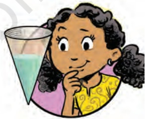
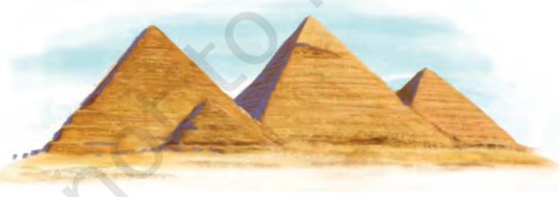
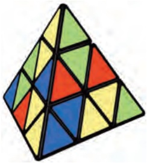

3. The height of a cone is 16 cm, and its base radius is 12 cm. Find the curved surface area and the total surface area of the cone.

4. A cone has a height of 15 cm. If its volume is 1570 cm3, find the radius of the base.

5. The curved surface area of a cone is 308 cm2 and its slant height is 14 cm. Find (i) the radius of the base, (ii) the total surface area of the cone.

6. A joker’s cap is in the form of a right circular cone of base radius 7 cm and height 24 cm. Find the area of the sheet required to make 10 such caps.

\*7. What length of tarpaulin 3 m wide is required to make a conical tent of height 8 m and base radius 6 m? Assume that the extra length of material that is required for stitching margins and wastage in cutting is 20 cm.

8. A right triangle with sides 6 cm, 8 cm and 10 cm is rotated through 360° about the side of 8 cm. Find the volume and the curved surface area of the solid so formed.

\*9. Suppose you have a cup in the shape of a right circular cone. Fill it with water to half the depth of the cone. What fraction of the volume of the cup is occupied by the water?

## 14.4 Pyramidal Shapes

A pyramidal shape is of the type shown in the following figures.

Fig. 14.11A

Fig. 14.11B

Its base may be a triangle, a square or indeed any closed shape. All points in the base are connected to a single point (the apex) which lies in a different plane. You can make the pyramids by using the cutouts of nets given at the end of the textbook.