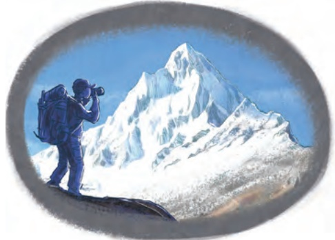
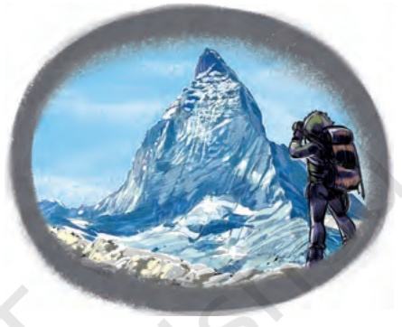
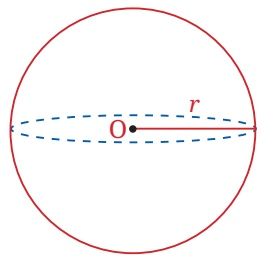

The famous pyramids in Egypt have square bases. The puzzle in Fig. 14.11B (made by the Hungarian architect Erno Rubik) has a triangular base.

Some mountains have pyramidal peaks (formed by glacier erosion over many millennia). In India, there is the Shivling Peak in the state of Uttarakhand. An example from the Alps is the Matterhorn.

Shivling Peak (Uttarakhand)

The Matterhorn (Switzerland)

The volume V of a pyramidal shape is found by using the formula

$$
V = \frac{1}{3} \times  area of phase  \times  height .
$$

The same formula is applicable whether the base is triangular, square or any other shaped flat surface.

Note that the formula is the same as the one used for the volume of a cone. Indeed, we may think of a cone as a pyramid with a circular base.

The surface area of a pyramidal shape is found by adding up the areas of all the polygonal faces. So, we do not need a separate formula for the surface area.

## 14.5 Spheres and Hemispheres

Volleyball

Football (Soccer)

Sphere

Lastly, we consider a familiar object in daily life: a ball or a sphere.