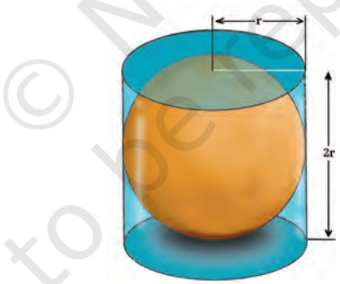

This is the three-dimensional (3D) equivalent of a circle. Whereas a circle is the collection of all points **in a plane** that are at some given distance from some given point, a sphere is the collection of all points in 3D space that are at some given distance r (the radius of the sphere) from a given point O, the centre of the sphere. If we rotate the circle about any diameter, we obtain a hollow sphere.

Archimedes showed that the surface area A of a sphere with radius r is equal to $4 \pi r ^ { 2 }$ . He did this by showing that the surface area of a sphere is exactly equal to the curved surface area of a cylinder with radius r and height h = 2r that fits tightly over the sphere, Fig. 14.12.

Fig. 14.12

The curved surface area of such a cylinder is equal to

$$
2\pi r h = 2\pi r \times 2r = 4\pi r^{2},
$$

This is the formula obtained by Archimedes.