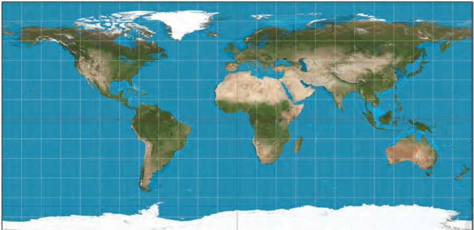

Fig. 14.13: Rectangular map projection Source: https://en.wikipedia.org/wiki/Equirectangular\_projection#/media/File:Equirectangular\_projection\_SW.jpg

In passing, we note that this result is used in cartography (map-making), when making a rectangular map projection of the earth. Imagine a cylinder tightly wrapped around the earth, touching it at the equator, as described above. By drawing radial lines from the central north pole–south pole axis, we project horizontally from the earth’s surface to the surface of the cylinder. Then, we unwrap the cylinder and obtain the desired map. The resulting world map is rectangular in shape which is easy and convenient to use. But it suffers from an important defect: there is great distortion in shapes at high latitudes (close to the poles). For locations close to the equator, the distortion is negligible.

Archimedes also found the formula for the volume V of a sphere:

$$
V   =   \frac { 4 } { 3 }   \pi r ^ { 3 } .
$$

You will study the derivations of these formulas in later grades, using calculus.

But you may be able to find your own derivation of the formula by connecting it with the formula for volume of a cone; namely, by writing it as

$$
V = \frac { 1 } { 3 } \times ( 4 \pi r ^ { 2 } ) \times \mathbf { r }   ,
$$

i.e., Volume of sphere $= \frac { 1 } { 3 }$ × surface area of sphere × radius of sphere.

Try to work out the connecting links on your own.