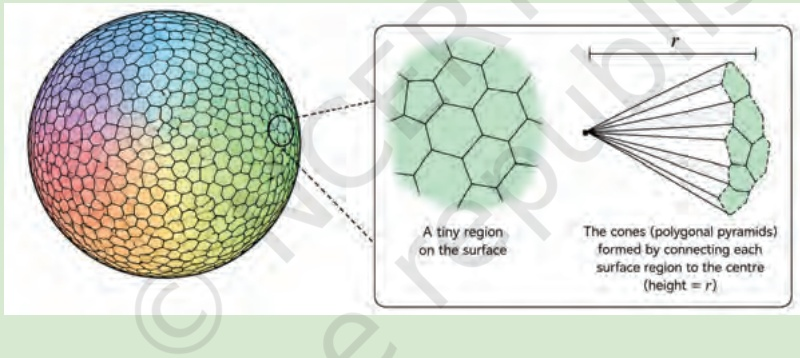

## \*Visualising Volume Formula

Here is a way to see the link between the formulas for volume of a cone, surface area of a sphere and volume of a sphere. Recall that

$$
\mathrm { V o l u m e ~ o f ~ c o n e } = { \frac { 1 } { 3 } } \; { \mathrm { a r e a ~ o f ~ b a s e } } \times { \mathrm { h e i g h t ~ o f ~ c o n e } } .
$$

Imagine that the entire surface of the sphere is divided into tiny regions. The shapes of these regions do not matter; what matters is that they are very tiny. Now connect all these regions to the centre of the sphere. This creates a large number of thin cones. They all have the same height, namely r. The volume of the sphere is equal to the sum of the volumes of all the cones. Using the fact that the cones all have the same height, we may write:

Volume of sphere $= { \frac { r } { 3 } }$ × sum of base areas of all the thin cones

$= { \frac { r } { 3 } } \times$ surface area of sphere $\frac{r}{3} \times 4\pi r^{2} = \frac{4}{3}\pi r^{3}$

## 14.5.1 Hands-on Activity to Verify the Formula for Surface Area of a Sphere

Have you ever played with a top? You must know how a string is wound around it. Take a rubber ball and drive a nail into it. Using the nail for support, wind a string tightly around the ball. When you have reached the ‘fullest’ part of the ball, use pins to keep the string in place, and continue to wind the

string around the remaining part of the ball, till you have completely