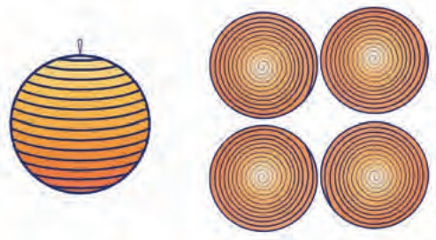
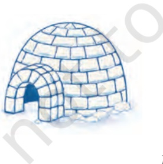
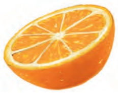

covered it; see Fig. 14.14. Mark the starting and finishing points on the string, and unwind the string from the surface of the ball. Now, measure the diameter of the ball and get its radius. On a sheet of paper, draw four circles with a radius equal to the radius of the ball. Fill the circles with the string you had wound around the ball (as shown in the figure).

Fig. 14.14

The string, which had completely covered the surface of the sphere, has now been used to fill the four circles, all with the same radius as the sphere. So, the surface area of a sphere of radius r is equal to 4 times the area of a circle of radius r, i.e., equal to 4πr2. Hence, surface area of a sphere $= 4 \pi r ^ { 2 }$ where r is the radius of the sphere. This experimentally verifies the stated formula.

## 14.5.2 Hemisphere

A hemisphere is a three-dimensional solid formed when a sphere is cut into two equal halves by a plane passing through its centre. The flat circular region formed after cutting the sphere is called the base of the hemisphere. A hemisphere has one curved surface and one circular base. See Fig. 14.15.

Fig. 14.15: Hemispheres

You may also recall encountering the term hemisphere in the context of the Northern Hemispheres and the Southern Hemispheres in Geography.

Examples: Bowls, serving dishes, dome-shaped covers, planetariums and igloos.