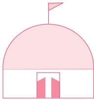
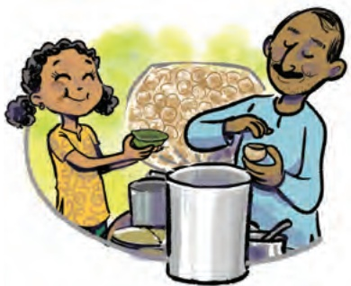

\*7. The radius of a sphere is increased by x%. The volume of the sphere increases by 72.8%. Find the value of x.

8. The hemispherical dome of a building needs to be painted (see Fig. 14.16). If the circumference of the base of the dome is 35.2 m, find the cost of painting it, given the cost of painting is ₹ 10 per 100 cm2.

Fig. 14.16

## 14.6 Areas and Volumes Around Us

We learned about different 3D solids. Identify and list objects or structures around you that are cubical, cuboidal, cylindrical, conical, spherical, or pyramidal in shape, or closely resemble these shapes.

**Activity:** Find the approximate volumes of a gas cylinder, a bucket, any cylindrical vessel, a cupboard, a water tank that you can find near you (use 1000 cm3 = 1 litre).

## 14.6.1 Guesstimates: Did You Ever Wonder?

Guesstimate questions are problems in which you make a reasonable estimate for a quantity when exact data are not available. Instead of finding a perfectly accurate answer, you use assumptions, approximations, logic, and everyday knowledge to model a given situation and arrive at a sensible estimate. Do you remember solving such questions in earlier grades?

**Example 5:** Lallan’s golgappa (a small hollow ball made of wheat) stall has a cylindrical vessel with pani (spiced water) in it. The vessel is of radius 10 cm and it has pani up to a height of 50 cm. Estimate the number of golgappas he can serve assuming all golgappas are spheres. Before calculating, make a guess.

Can you guess what number this could

be — is it in the hundreds, thousands, or more?

The number of golgappas that can be served is Total pani in the vessel Volume of pani in each golgappa