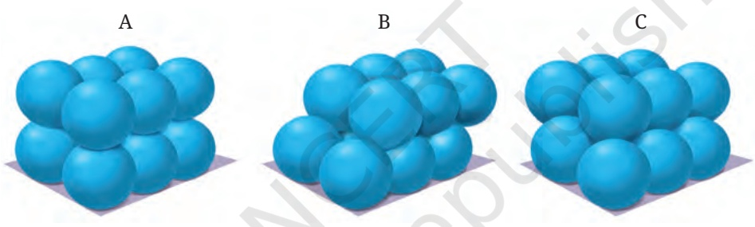

The volume of the classroom is

$$
3 0 \times 3 0 \times 1 5 = 1 3 , 5 0 0 \mathrm { f t ^ { 3 } } \approx 3 7 , 8 0 , 0 0 , 0 0 0 \mathrm { c m ^ { 3 } } .
$$

Can we find the number of tennis balls that can fit in the classroom by dividing the volume of the classroom by the volume of a tennis ball?

$$
1\  ft =30.48\  cm
$$

$$
1 ~ \mathrm { f t ^ { 3 } \approx 2 8 3 1 7 ~ c m ^ { 3 } }
$$

$$
\frac { 3 7 , 8 0 , 0 0 , 0 0 0 } { 1 1 3 }   \approx   3 3 , 4 5 , 1 3 2 .
$$

$$
1 ~ \mathrm { f t } \approx 3 0 ~ \mathrm { c m }
$$

$$
1 ~ \mathrm { f t ^ { 3 } \approx 2 8 0 0 0 ~ c m ^ { 3 } }
$$

No, the balls cannot fit in the room without leaving gaps in between. Hence this operation will only give an upper bound value, i.e., we can say for sure that we cannot fit more balls than this.

Accounting for these gaps can give a better estimate.

Fig. 14.17: These are some of the ordered ways of packing spheres in a cuboidal structure

**Using the first configuration:** Along each side of the room, the number of balls that can be placed side-by-side along the length is dimension of the $\frac{\mathrm{room}}{\mathrm{ball}} \approx \frac{900}{6} = 150$. The same number can be placed diameter of the along the width. Along the height, it is 75 balls.

Therefore, 150 × 150 × 75 = 16,87,500 denotes the approximate number of balls that can fill the room.

Using the other configurations, we might be able to fit more balls because of higher packing efficiency.

Make an estimate based on the second and third configurations.

**Note:** This is why spheres are not used as basic units to measure volumes as they leave gaps unlike cubes.