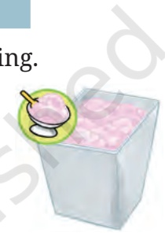
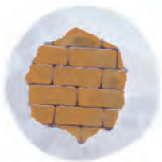

As we have seen in guesstimate problems, different people may get different answers, but the reasoning they use matters the most. For these problems, you can start with a quick intuitive guess, model the situation by identifying the relationships among the quantities, make reasonable assumptions, and then calculate an answer by making suitable approximations. Look back to see how close your intuitive guess is to your estimate.

## End-of-Chapter Exercises

For guesstimate problems, make a guess first before solving.

1. Estimate how many scoops of ice cream can be obtained from a cuboidal container of dimensions 10 cm × 15 cm × 20 cm.

2. A cube of integer side length a is made of unit cubes. Write an expression giving the number of unit cubes to be added to make a cube of side length a + 1.

\*3. Solve the following:

(i) Could a person drink enough water in a lifetime to fill an entire room the size of your classroom?

(ii) Estimate the number of bricks used to build the walls of your classroom.

4. You are given two options: (A) one chocolate cube of side 50 mm, (B) hundred chocolate cubes of side 10 mm. Which option gives you more chocolate? XC

5. If all the people in the world are crowded together in one location, how much area would it cover?

6. A school provides milk to its students in cylindrical glasses, each with a diameter of 7 cm. If each glass is filled with milk to a height of 12 cm, how many litres of milk

are needed to serve 1600 students? Use 1000 cm3 = 1 litre.

7. The surface area of a sphere of radius 5 cm is five times the area of the curved surface of a cone of radius 4 cm. Find the height and the volume of the cone.