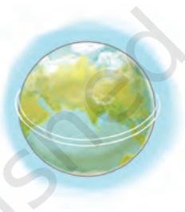

8. Take Earth to be a perfect sphere with radius 6370 km. Take Jupiter to be a perfect sphere with radius 69,900 km. Take the Sun to be a perfect sphere with radius 6,95,700 km. Compute approximately:

(i) the ratio of the volume of Jupiter to the volume of the Earth;

(ii) the ratio of the volume of the Sun to the volume of the Earth. (Calculator can be used.)

9. Show that the volume of a sphere is equal to $\frac { 2 } { 3 }$ of the volume of the smallest cylinder which encloses it.

\*10. Suppose the Earth is perfectly spherical. A string is wrapped tightly around the equator of the Earth. Another string, 1 metre longer, is placed around the Earth so that it forms a larger circle, staying the same distance above the ground everywhere.

How high above the ground is the second string?

Repeat this for: (i) the Moon (ii) Jupiter (iii) a volleyball. Are you surprised by the three answers? Why or why not?

\*11. We have a cylinder with a base radius of r cm and height h cm. A square pyramid is fitted inside it. The square base of the pyramid lies on the base of the cylinder, its corners on the boundary of the cylinder. The apex of the pyramid lies on the top of the cylinder. Find the ratio of the volume of this pyramid to the volume of the cylinder.

12. What is the change in volume when:

(i) the length of a cuboid with dimensions l, w, h is increased by 1 unit? (a) 1 cubic unit (b) $( l w h + 1 )$ cubic unit (c) wh cubic units (d) lw cubic units (e) lh cubic units

(ii) the radius of a cylinder with dimensions r, h is increased by 1 unit? (a) 1 cubic unit (b) $\pi r ^ { 2 }$ h cubic units (c) $\pi r ^ { 2 }$ cubic units (d) $2 \pi r h \pm 2 \pi h$ cubic units (e) $2 \pi r h + \pi h$ cubic units

\*(iii) the radius of a sphere is decreased by 1 unit?

\*13. Given a cube with volume V, express its total surface area S in terms of V.