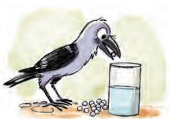
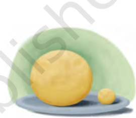

\*14. Given a cube with total surface area S, express its volume V in terms of S.

15. A cylindrical glass of height 25 cm and radius 4 cm has water up to a height of 16 cm. A crow wants to drink water from this glass. The water must be at a height of 20 cm for the crow to reach it. There are some marbles lying around. How many marbles of radius 1 cm should the crow drop into the glass to make the water reach the required height? make the water reach the reguired heig

16. Find the volume of ink in a new ball point pen. Take the necessary measurements and make approximations, as needed.

17. Solve:

(i) A ball of chapati dough of radius 6 cm is prepared. Estimate how many chapatis can be made from it?

\*(ii) Cut a coconut/muskmelon in half and find out the approximate volume of edible coconut flesh/fruit by taking the necessary measurements.

18. Looking at the Ganita Manjari, Grade 9, Part 2 textbook, Sheela wonders:

(i) If all the pages of this textbook were laid out side-by-side on the floor would they cover the entire classroom floor?

(ii) What is the maximum number of textbooks that can fit in an empty storeroom of dimensions 15 ft × 20 ft × 30 ft?

\*19. If the entire human population decided to climb into one giant cube, how long would the side have to be?

\*20. The Earth’s surface has an estimated volume of 1.38 billion km3 of water. Suppose the Earth is a perfect sphere and all this water forms a uniform layer completely covering the Earth’s surface, like a thin water bubble. Estimate the thickness of this water layer. The Earth’s radius is \~6371 km.

