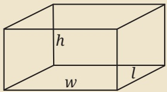
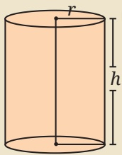
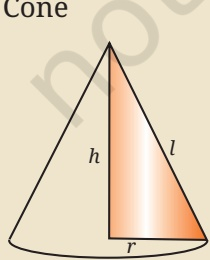

(i) Write an expression that gives the thickness of this water layer.

(ii) Simplify the expression in (i) using a calculator.

\*21. Give the dimension of a cuboid whose volume is halved when its surface area is doubled.

22. **Project:** Find the volume of your house making necessary approximations. Present how you solved it.

## Chapter Summary

In this chapter, we have studied the following formulas for the surface areas and volumes of various fundamental shapes.

<table><tr><td>3D Shape</td><td>Surface Area</td><td>Volume</td></tr><tr><td>Cuboid 1.</td><td> $2(wl+hw+lh)$ </td><td>whl</td></tr><tr><td></td><td>Curved surface area: 2πrh</td><td> $\pi r ^ { 2 } h$ </td></tr><tr><td>Right Circular 2. Cylinder </td><td>Total Surface Area of a cylinder covered at one end:  $2\pi r h+\pi r^{2}=\pi r(2h+r)$  Total Surface Area of a cylinder covered at both ends:  $2 \pi r h + 2 \pi r ^ { 2 } = 2 \pi r ( h + r )$ </td><td></td></tr><tr><td>Right Circular </td><td>Curved surface area: πrl Total surface area: πr(l + r)</td><td> $\frac { 1 } { 3 } \pi r ^ { 2 } h$ </td></tr></table>