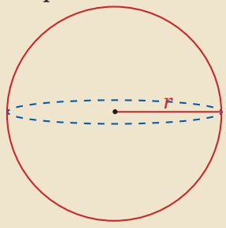
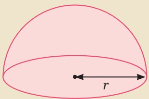

<table><tr><td>4. Sphere</td><td> $4 \pi r ^ { 2 }$ </td><td> $\frac { 4 } { 3 }   \pi r ^ { 3 }$ </td></tr><tr><td>5. Hemisphere</td><td>Curved surface area: $2 \pi r ^ { 2 }$ Total surface area: $2 \pi r ^ { 2 } + \pi r ^ { 2 }$  $= 3 \pi r ^ { 2 }$ </td><td> $\frac { 2 } { 3 }   \pi r ^ { 3 }$ </td></tr></table>