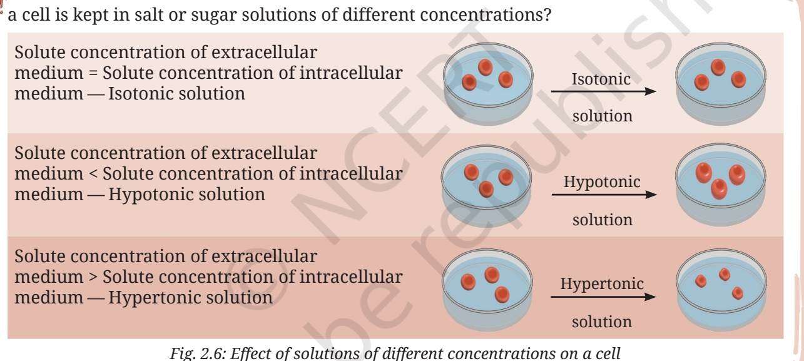
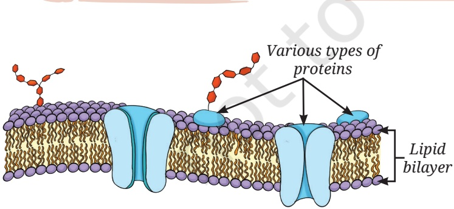

## What if .

mung bean seeds are kept in a concentrated solution after soaking in water for 12 hours? What will happen to them?

What do you **infer**? What do you expect in terms of changes in their weight? The weight of the potato piece in Beaker A has increased, while the weight of the potato piece in Beaker B has decreased. This happens because the cell membrane allows water to move in and out of the cell but not the sugar or salt molecules. Water moves from an area with more water and less solute (dilute solution) to an area with less water and more solute (concentrated solution) until the concentrations in the two areas become equal. This movement of water through a selectively permeable membrane is called **osmosis**. You have learnt in Activities 7.8 Grade 8 (dye spreading in water) and 7.9 (fragrance spreading in air) in Chapter 7 Grade 8 that particles of matter intermix, due to a difference in their concentrations, also called a concentration gradient. **Diffusion** is the net movement of particles from a higher to a lower concentration (which occurs even without a membrane). Osmosis is the diffusion of water across a selectively permeable membrane. In plants, water from the soil enters root cells by this process of osmosis.

## What if ...

a cell is kept in salt or sugar solutions of different concentrations?

Solute concentration of extracellular medium = Solute concentration of intracellular medium — Isotonic solution

Solute concentration of extracellular medium < Solute concentration of intracellular medium — Hypotonic solution

Isotonic solution

Solute concentration of extracellular medium > Solute concentration of intracellular medium — Hypertonic solution

<u>Hypotonic</u> solution

<u>Hypertonic</u> solution

Fig. 2.7: Structure of a cell membrane

Structurally, the cell membrane is extremely thin, about 7 to 10 nanometres (nm) thick (1 nanometre = 0.000001 mm). It is made up of lipids (fats) and proteins. The **fluid-mosaic model** explains its structure (Fig. 2.7) :

y The membrane has a lipid bilayer (two layers of special fat molecules with water attracting heads outwards and water repelling tails inwards) with proteins embedded in them.

y The molecules can move sideways, flip and rotate within the membrane. Hence, it is **fluid**.

y Proteins in the membrane act like gatekeepers in helping substances pass through.