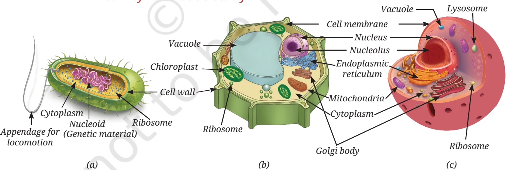

Without a rigid cell wall, animal cells can change shape easily. This cellular flexibility supports the overall movement and functioning of animal tissues.

The plant cell wall is primarily made of cellulose, a type of carbohydrate formed by many glucose units linked together. Cellulose in our diet acts as roughage, helping in digestion. Some microorganisms, like fungi and bacteria also have a cell wall to provide protection and structural support to their cells.

## Pause and Ponder

1. What argument would you give for the necessity of a cell wall in plants usually fixed in one place versus in animals usually moving from one place to the other?

2. What consequences would you predict for a plant cell if its cell wall were to become as flexible as a cell membrane?

3. Why is it important to cut the two potato pieces in roughly equal size and measure their initial weight before placing them in different liquids?

## 2.3 The Cell Interior — A Coordinated Working System

You have learnt that most cells have three basic parts:

y a selectively permeable membrane called the plasma Chapter 9 membrane,

y a semi-fluid, jelly-like substance called the cytoplasm, and

y a prominent nucleus.

In addition to the nucleus, the cytoplasm contains several sub-cellular components called **organelles,** along with other substances present in it, most of which are only visible with an electron microscope.

Activity 2.4: Let us study

Fig. 2.10: (a) A typical bacterial cell, (b) a typical plant cell, and (c) a typical animal cell

1. Study the given diagrams of a bacterial cell, a plant cell, and an animal cell (Fig. 2.10a, b and c).

2. Observe the different structures present in each of them.

3. Record your observations in Table 2.1.

A bacterial cell lacks a well-defined nucleus and membrane-bound organelles (organelles surrounded by their own membranes). Such cells are called **prokaryotic cells** (pro means primitive and karyon means