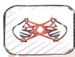
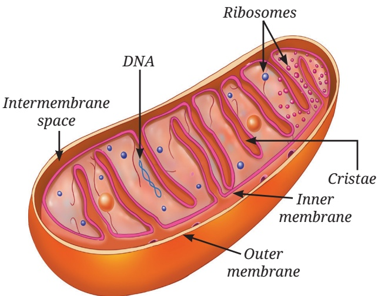
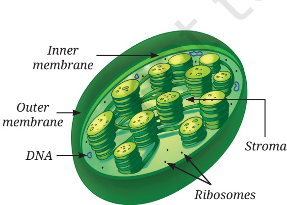

damaged parts of the cell, keeping it clean and healthy. The products formed by the breakdown are released into the cytoplasm, where they may be reused in other cellular processes.

## Threads of Curiosity

Human sperm cells contain lysosomal enzymes. When a sperm meets an egg, these enzymes help break down the outer layer of the egg, allowing fertilisation to take place. You will learn about the human sperm cells later in Chapter 11.

Fig. 2.14: Structure of a mitochondrion

## Mitochondria — The powerhouse of the cell

Mitochondria are often called the ‘powerhouses of the cell’ because they supply the energy needed for most cellular activities. Each mitochondrion (Fig.

2.14) is surrounded by two membranes :

y The **outer membrane** is smooth and porous.

2 **Grade 7** Curiosity **Chapter 9**

y The **inner membrane** is folded into finger-like projections called **cristae**, which increase the surface area for chemical reactions and facilitate energy production.

In mitochondria, the glucose and other molecules are broken down to release energy

during a process called cellular respiration. You have already studied about it. The energy released is stored in the form of a molecule called Adenosine Triphosphate (ATP), which acts as the energy currency and is used for most of the cellular activities.

## Plastids — Centre for food synthesis in the plant cells and beyond

You have learnt that mitochondria provide energy to the cell that comes from food. Animals can obtain food from their surroundings, however, plants synthesise food in the presence of sunlight. But where do plants synthesise their food and obtain energy for cellular activities? Plants use special organelles called **plastids** for food synthesis and storage.

Fig. 2.15: Structure of a chloroplast

As you have learnt, plants prepare their Grade 7 food by the process of photosynthesis in the Curiosity Chapter 9 presence of sunlight. A green pigment called **chlorophyll**, which is present in the chloroplast (a type of plastid) absorbs sunlight. Chloroplasts are double-membrane-bound organelles, like mitochondria. Inside the chloroplast (Fig. 2.15) there is a semi-fluid substance called the **stroma**. Within the stroma are disc-shaped membrane structures that contain chlorophyll. Light energy is absorbed

