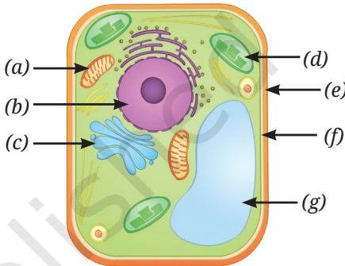

Cells are observed after some time. Cell X swells, and Cell Y shrinks. Which statement provides the correct explanation for the above observations?

(i) Salt molecules moved into Cell Y, causing it to shrink.

(ii) Water moved into Cell X and more water moved out of Cell Y than the salt solution entered in it.

(iii) Water moved into Cell X and moved out of Cell Y through the cell membrane.

(iv) Solute movement caused osmosis in both cells.

3. Look at the diagram of a cell in Fig. 2.20. Identify the parts labelled from (a) to (g) and correctly match them with their functions given below:

(i) Controlling all the activities of a cell.

(ii) Site of cellular respiration.

(iii) Storage organelle that also provides rigidity to the cell.

(iv) Separates the cell contents from surroundings.

(v) Provides structural rigidity to the cell.

(vi) Packs and stores materials received from ER.

(vii) Helps in manufacturing food.

4. Which of the following option(s) of the pairs of cell organelles are correctly placed under the given categories?

Fig. 2.20

<table><tbody><tr><td rowspan="2">Option</td><td rowspan="2">Present in the plant cells</td><td rowspan="2">Absent in the animal cells</td></tr><tr></tr><tr><td>(i)</td><td>Leucoplast</td><td>Cell wall</td></tr><tr><td>(ii)</td><td>Mitochondria</td><td>Ribosome</td></tr><tr><td>(iii)</td><td>Cell wall</td><td>Golgi apparatus</td></tr><tr><td rowspan="2">(iv)</td><td rowspan="2">Lysosome</td><td rowspan="2">Endoplasmic reticulum</td></tr><tr></tr></tbody></table>

5. Two students, Renu and Rohit, were having a discussion on the plastids. Renu emphasised that all parts of the plants, even roots, contain plastids. However, Rohit did not agree with the statement and told her that plastids are absent in plant roots since the roots are underground and do not need to perform photosynthesis. Who is correct? Justify your answer.

6. Mitochondria and chloroplasts are two important organelles in a plant cell. Discuss how these two organelles are structurally and functionally similar to each other, and different from each other.

7. Which of the following pairs of cell organelles contains DNA?

(i) Chloroplasts, Ribosomes

(ii) Mitochondria, Nucleus

(iii) Golgi bodies, Ribosomes

(iv) Nucleus, Lysosomes