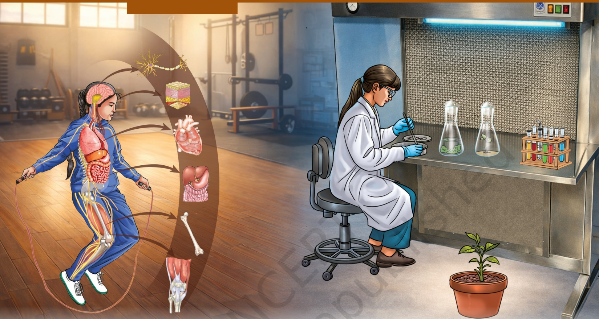

0906CH03

## Tissues in Action

## Think It Over

How is the study of cells and tissues significant for understanding the life processes and human welfare?

How are tissues in plants and animals different, and why?

How is the division of labour at various levels of organisation in multicellular organisms correlated with their structure and function?

Life begins when a single cell divides itself several times to give rise to a large number of cells. These cells gradually form the skin (protection), muscles (movement), bones (support), nerves (control and coordination), and all other organs. This process is so intricate that it is considered one of nature’s greatest engineering marvels. Researchers have been trying to understand, replicate and modify this process for human welfare. To do so, it is essential to understand the natural biological processes that govern growth and development in plants and animals. What makes cells group together to form tissues? Why do some tissues grow throughout life while others do not?

In Chapter 2, Cell: The Building Block of Life, you have learnt that the cell is the basic unit of life. Many cells come together to form a multicellular organism. In all multicellular organisms, there is a hierarchy of organisation. Cells of similar type performing similar function group together to form a **tissue**, more than one type of tissues form **organs**, different organs form **organ systems** and organ systems form an **organism**. In unicellular organisms, such as amoeba, a single cell performs all functions of life. In multicellular organisms like plants and animals, different groups of cells perform different functions. A **tissue** is a group of cells (similar in structure) that work together to perform a specific function. The formation of different types of tissues leads to the division of labour, which increases the efficiency of the body and enables it to carry out complex life processes. For example,