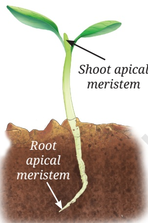
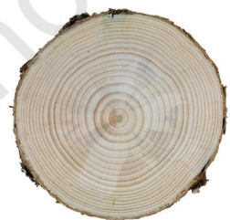

for four more days (day 4 onwards), and record your observations in Table 3.1.

Table 3.1: Experimental data

<table><tbody><tr><td rowspan="2" colspan="2">Experimental Jars</td><td colspan="8">Length of onion root (cm) from the base of the bulb</td></tr><tr><td>Day 1</td><td>Day 2</td><td>Day 3</td><td>Day 4</td><td>Day 5</td><td>Day 6</td><td colspan="2">Day 7</td></tr><tr><td colspan="2">A</td><td></td><td></td><td></td><td></td><td></td><td></td><td colspan="2"></td></tr><tr><td colspan="2">B</td><td></td><td></td><td></td><td></td><td></td><td></td><td colspan="2"></td></tr></tbody></table>

Fig. 3.2: Growth of onion roots

What trend do you **observe** in the data you recorded in Table 3.1? Are your observations similar to those presented in the graphical representation (Fig. 3.2)? What do you infer?

Roots in Jar A continue to grow in length.

Roots in Jar B stop growing after the tips are cut.

This shows that roots grow only from their tips. The tips consist of cells which divide continuously.

You may recall observing mitosis in onion root tips in Chapter 2, Cell: The Building Block of Life. This observation confirms that root tips contain actively dividing cells. Similarly, shoot tips also contain actively dividing cells that help the

shoots to grow in length. Thus, we conclude that plants have growth zones at the tips of their roots and shoots, called the **apical meristems**, which help the plants grow in length (Fig. 3.3).

## 3.2.2 Lateral meristem — How do plants grow in girth?

Shoot apical meristem

Look at your surroundings. You must have observed that the stems of dicot plants not only grow in length but also increase in diameter or girth over time. What causes this increase in girth? One possible explanation may be

Fig. 3.3: Location of apical meristem in a sapling

Fig. 3.4: T.S. of a tree trunk showing annual growth rings

the activity of meristematic tissues. If you have visited a timber yard or observed the cut trunk of a tree, you may have noticed several ring-like patterns on the cut surface of the wood (Fig. 3.4). These are annual growth rings. Some annual rings are wide and some are narrow, reflecting the favourable or unfavourable growth conditions during a particular year. By counting these annual rings, scientists can estimate the age of a tree and also understand the climatic conditions under which it grew.