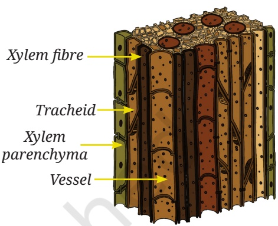
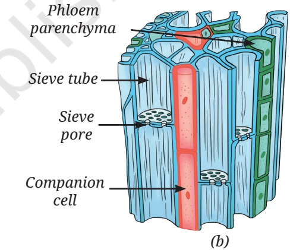
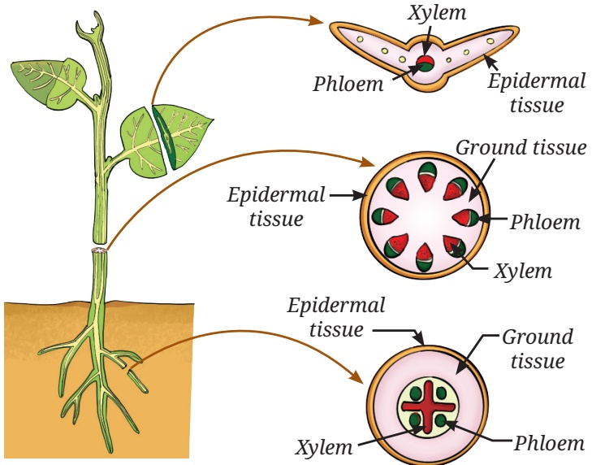

This tissue provides support and flexibility, allowing parts of the plant like stems and tendrils to bend without breaking.

## c. Sclerenchyma

Sclerenchyma cells have thick walls (Fig. 3.8c) due to deposition of lignin, making them hard and strong (forms the woody structure). Most of these cells are dead. This tissue is found in stems, leaf veins, and hard coverings of seeds and nuts, such as coconut husk and walnut shell.

## (iii)	Conducting tissues — Complex permanent tissues

How does water reach the leaves of tall trees? How does food prepared in leaves reach other parts of the plant?

Plants have specialised conducting tissues called **xylem** and **phloem**, together known as **complex permanent tissues**, because they are made up of different types of cells working together. Xylem (Fig. 3.9a) is the tissue that transports water and minerals from the roots to other parts of the plant. It also provides strength to the plant. Xylem consists of tracheids, vessels, xylem parenchyma and xylem fibres. Tracheids and vessels are tubular and thick-walled. Xylem parenchyma are the only living component of xylem while trachieds, vessels, and xylem fibres are primarily sclerenchymatous. Unlike the xylem, phloem is mostly made up of living cells (Fig. 3.9b). It consists of sieve tubes, companion cells, phloem parenchyma and phloem fibres. Some cells are long and tubular, joined end to end by perforated walls. These cells form **sieve tubes**. Sieve tubes transport food from leaves to other parts of the plant. The cellular functions of the sieve tube cells are regulated by **companion cells**. Companion cells are specialised parenchyma cells. Main function of companion cells is to monitor loading and unloading of sugars in sieve tubes.

Phloem parenchyma store food materials, and resin, tannins and latex. The sieve tubes are also supported by phloem fibres which are primarily schlerenchymatous and provide strength.

So far, we have studied different types of plant tissues based on their functions — protection, support and conduction. In a plant body, these tissues do not work alone. They are organised together into larger groups called **tissue systems**.

Plant tissues are organised into three tissue systems (Fig. 3.10) —

1. **Dermal tissue system:** This forms the outer covering of the plant. It protects the inner parts and reduces water loss.

## Pause and Ponder

1. You may have noticed that fibres of coconut husk are hard and brittle, whereas the leaf stalks of coriander are soft and flexible. Find out the reason.

(a)

Fig. 3.9: Vascular tissue: (a) xylem, and (b) phloem

Fig. 3.10: Tissue systems in plants