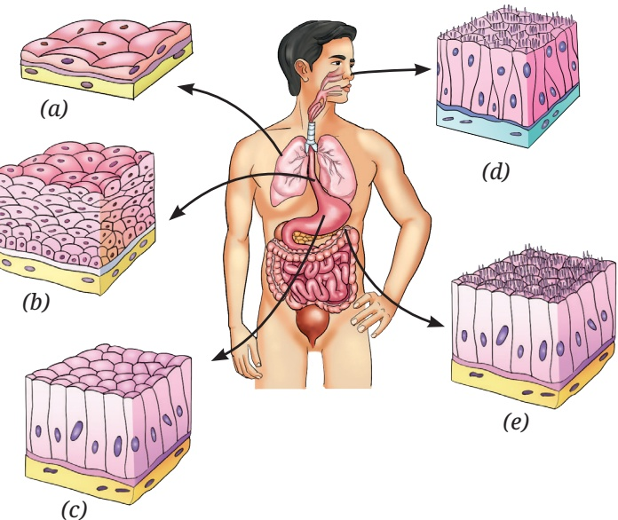

water loss, and also helps in the absorption, secretion and movement of substances. Different types of epithelial tissues are structurally adapted to perform different functions (Table 3.2).

Study Table 3.2 along with the corresponding diagrams shown in Fig. 3.11 to understand how structure and function of epithelial tissues are related.

Table 3.2: Characteristics of functionally and structurally different epithelial tissues

| Function | Structure | Location in the body |
| --- | --- | --- |
| Exchange: Helps in rapid | Single layer of thin, flat cells (Fig. | Lining of the tissue in |
| diffusion of liquids and | 3.11a) | the blood vessels and |
| gases |  | lungs |
| Protection: Protects | Many layers of cells; the outer | Skin, mouth and |
| underlying tissues from | cells are flat and tightly packed | oesophagus |
| mechanical injury, friction | (Fig. 3.11b) |  |
| and entry of microbes |  |  |
| Secretion: Production | Cells specialised for producing | Salivary glands, sweat |
| and secretion of mucus, | and releasing substances; may | glands and stomach |
| enzymes, hormones, sweat | be cuboidal or columnar | lining |
| saliva | (Fig. 3.11c) |  |
| Sensory functions: Smell, | Specialised receptor cells having | Nostrils, taste buds |
| taste, sound and balance | hair like cilia (Fig. 3.11d) | and inner ear |
| Absorption: Efficient | Single layer of tall, pillar- | Lining of small |
| uptake of nutrients, water, | like cells, often with hair-like | intestine |
| etc. | structure (Fig. 3.11e) |  |

## 3.3.2 How are various parts connected in our body?

You have read that blood connects different parts of the body by transporting nutrients, gases, hormones, etc. Grade 7 In the same way, bones connect Curiosity Chapter 9 and support the body from head to toe. A tissue that connects and supports other tissues is called a **connective tissue**. Both blood and bones are connective tissues. Though both are connective tissues, they differ in composition and consistency. Blood is fluid, while bone is hard. This difference is due to the matrix, which is watery, soft and jelly‑like in blood but hard, solid, and rigid in bones (Fig. 3.12a).

Fig. 3.11: Types of epithelial tissues in different parts of the body