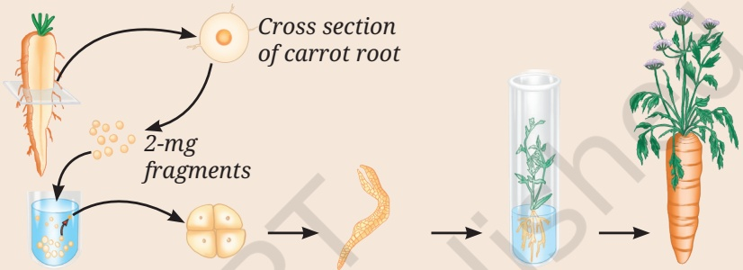

**From one cell to an organism: Totipotency**

In 1958, F. C. Steward demonstrated that even single cells from vascular phloem of carrot retain the ability to regenerate whole plants. He was the first person to do so!

He and his team conducted an experiment using the phloem cells of carrot. He grew these cells in a nutrient medium containing simple sugars and hormones under appropriate conditions. He observed that these phloem cells divided to form a mass of cells, which gradually divided and differentiated into a complete plant.

It shows that cells of phloem first dedifferentiated (cells regain the ability to divide) to form an undifferentiated mass of unspecialised cells. These, when grown in appropriate

conditions, supplemented with nutrients and growth chemicals, further divided and redifferentiated to form roots, shoot, and eventually the complete plant. Thus, some mature plant cells have the ability to undifferentiate, divide and redifferentiate to develop into a new plant under specific conditions. This is known as totipotency and such cells are totipotent cells. This is similar to the ability of a zygote to divide and differentiate into an entire organism.

Fragments Single cells Embryonic Plantlet was Adult were cultured free in plant cultured plant in nutrient suspension developed on agar medium; began to from a medium, stirring caused divide cultured and later single cells to single cell planted in shear offinto soil the liquid

Fig. 3.19: Regeneration of a carrot plant

In his experiment on phloem cells of carrot, F. C. Steward used different combinations of nutrients and other factors, and obtained the following results.

**Table 3.6: Effect of light, air and nutrient medium on growth of the cultured plant cells**

<table><tbody><tr><td colspan="2">Conditions</td><td rowspan="2">Composition of nutrient medium</td><td rowspan="2">Increase in fresh weight (mg) of the cells from intial weight</td></tr><tr><td>Light</td><td>Air</td></tr><tr><td></td><td></td><td>Solid medium + nutrients</td><td>reduced</td></tr><tr><td></td><td></td><td>Liquid medium + nutrients</td><td>20% increased</td></tr><tr><td></td><td></td><td>Liquid medium + nutrients</td><td>reduced</td></tr></tbody></table>

Based upon Table 3.6, think about these questions:

(a) What do you **conclude** about the characteristics of phloem cells of carrot?

(b) In which of the three combinations would you obtain the highest and lowest biomass? What could be the possible reason(s) for this observation?

(c) Will you get the same results if you culture animal cells instead of carrot cells?

(d) Think and mention any two commercial applications of the study above.