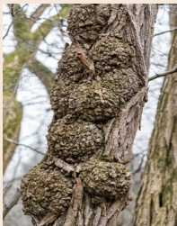
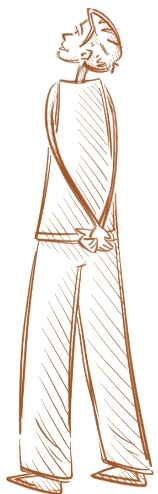

In nature, plant pathologists have observed a disease in plants called crown gall disease (Fig. 3.20). In this disease, tumour-like swellings develop on the stems due to rapid and uncontrolled cell division. The disease is caused by a bacterium called Agrobacterium tumefaciens.

Instead of only trying to cure this disease, scientists studied how a bacterium transfers its genetic material into plant cells. This knowledge was later used in plant tissue culture and genetic engineering. Today, Agrobacterium is used as a tool to introduce useful genes into plants for the production of valuable phytochemicals, improved crops and disease-resistant varieties.

Fig. 3.20: Crown gall disease

## At a Glance

Tissues are groups of similar cells that work together to perform specific functions.

Different tissues coordinate with one another to perform life processes in plants and animals.

Plant tissues are broadly classified into meristematic and permanent tissues, depending on their ability to divide.

Functionally, plant tissues can be categorised as protecting tissue, supporting tissue and conducting tissue.

Permanent tissues may be simple (made-up of one type of cell) or complex (made-up of more than one type of cell).

Simple permanent tissues include parenchyma, collenchyma and schlerenchyma.

Complex permanent tissues include xylem and phloem that transport water and food respectively to all parts of the plant.

Animal tissues are mainly of four types; epithelial, connective, muscular and nervous tissues.

Epithelial tissue forms the outer covering of the body or protective lining to internal organs to provide protection and other functions.

Connective tissue connects and supports various organs and tissues of the body.

Muscular tissue produces voluntary and involuntary movements for locomotion, and other movements in the body.

Nervous tissue consists of neurons to receive and transmit impulses, and helps regulate body activities.

Skeletal system protects organs and provides support.

In our body, movement occurs by the coordination of muscles and bones (musculoskeletal system), under the control of the nervous system.

